# Industrial AI Agent

**A read-only AI assistant for factory operations, connected to an external plant through MCP and evaluated with a benchmark, the way I would deploy it for a customer.**

A production manager asks: *"Something is wrong with the pressure in one of our controlled areas. Which asset is affected?"* The agent queries the plant, finds the alarm, reads the telemetry, and answers with the **asset, the parameter, its value and its limit**. It never controls equipment. A person decides what to do.

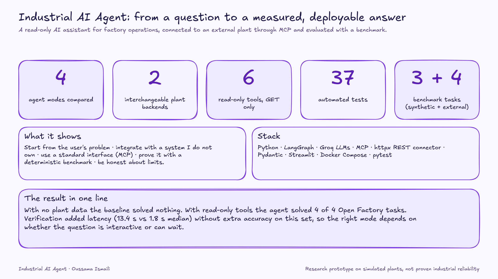

> **Honest scope:** research prototype. Two *simulated* plants, small benchmarks (3 and 4 tasks, one run per mode). It demonstrates an approach and a method, not proven industrial reliability.

## Contents

1. [Why this project](#why-this-project)
2. [How a question becomes an answer](#how-a-question-becomes-an-answer)
3. [Design decisions](#design-decisions)
4. [Results](#results)
5. [Run it](#run-it)
6. [Tests](#tests)
7. [Deployment](#deployment)
8. [Taking it to a real factory](#taking-it-to-a-real-factory)
9. [Known gaps](#known-gaps-and-next-steps)

## Why this project

The goal is to get an AI system working **inside a customer's environment**, not in a notebook. This project practises that loop end to end:

| Skill | Where it shows up here |
|---|---|
| **Start from the problem** | Operators need trustworthy answers tied to real constraints, not a chatbot. The question is "can I trust it, and at what cost?" |
| **Integrate with a system I don't own** | A connector to the [Open Factory Demo Factory](https://github.com/Open-Factory-Initiative/Demo-Factory) over REST, with retries, timeouts and schema validation |
| **Use standard interfaces** | Tools exposed through an **MCP server**. The agent works over MCP or in-process with identical behaviour |
| **Same agent, different customer system** | One `FactoryBackend` interface. Switching plant is an environment variable |
| **Safety by design** | Read-only tools. Fault injection exists only in the test harness |
| **Prove it works** | A benchmark with deterministic ground truth, strict scoring, and latency, verification and escalation metrics |
| **Be honest about limits** | Gaps are listed at the end, including what was not verified |

## How a question becomes an answer

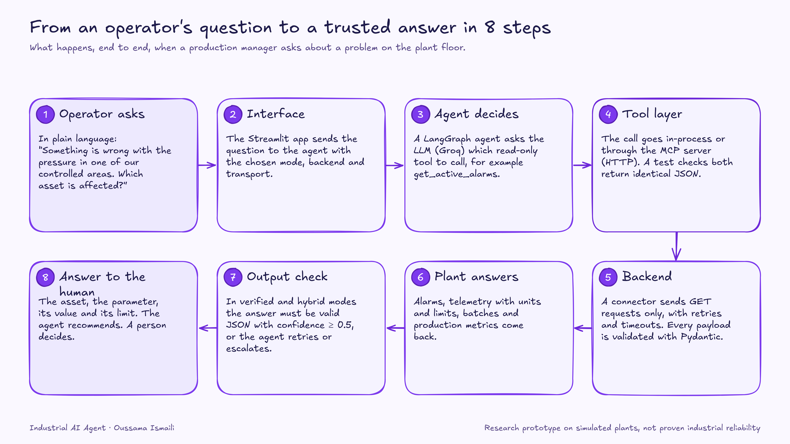

The agent is a LangGraph state machine with four modes, so the same tasks can compare ways of combining an LLM, tools and verification:

| Mode | What it adds |
|---|---|
| `baseline` | Nothing. The LLM answers alone, with no tools |
| `tool` | Read-only tools on the plant |
| `verified` | An output check (valid JSON, confidence ≥ 0.5) with up to 2 retries |
| `hybrid` | A small model first, escalating once to a larger model if the check fails |

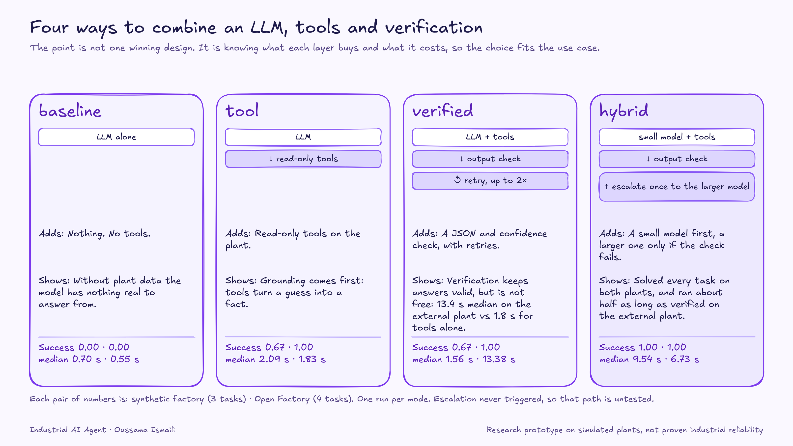

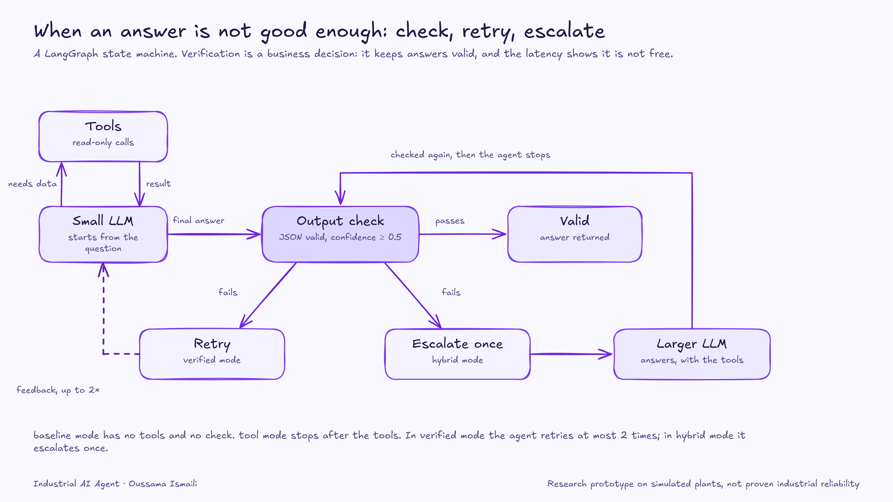

## Design decisions

**1. Read-only by construction.** Agent tools issue only `GET` requests. The benchmark harness injects faults to create a known plant state. The agent can neither cause the fault nor see how it was made. A test checks that the agent's tools cannot change the plant.

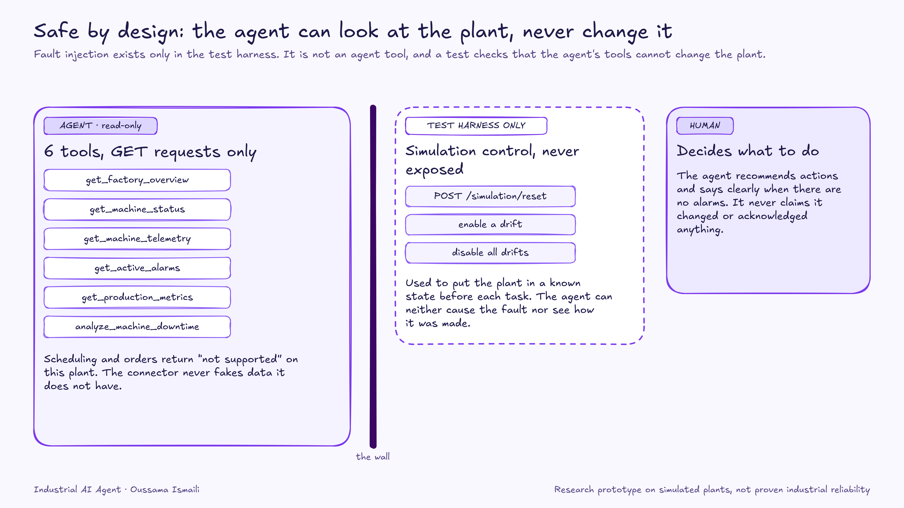

**2. One interface, any plant.** The agent and the MCP server talk to `FactoryBackend`. The synthetic simulator and the Open Factory connector both implement it, so the original benchmark stays comparable.

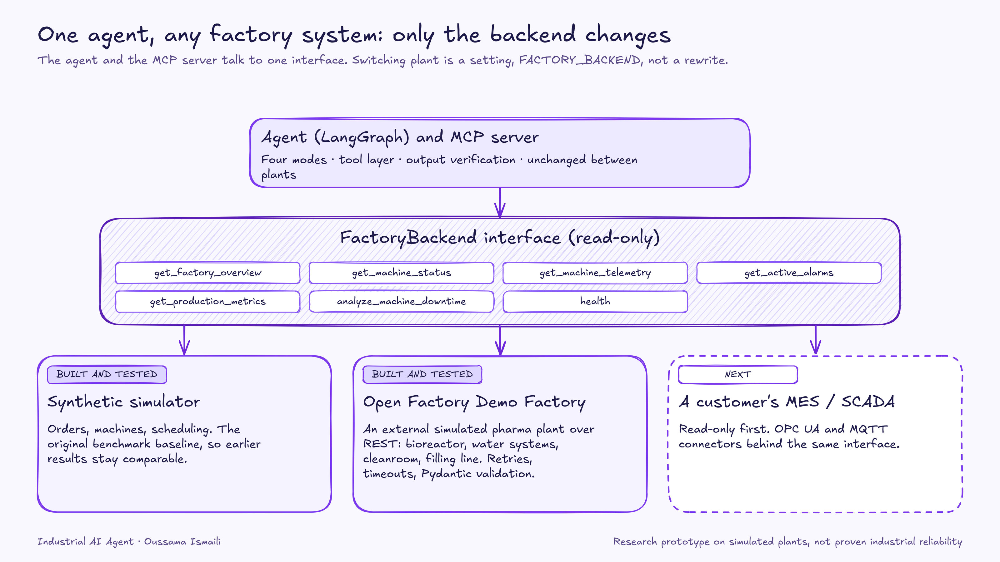

**3. Honest mapping to the customer system.** The Demo Factory has no orders and no downtime counters. The connector does not fake them: scheduling answers "not supported", and `analyze_machine_downtime` reports the assets currently in warning or alarm with parameter, value and limit.

**4. Validate the integration boundary.** Every API payload is parsed with Pydantic, so a missing or mistyped field becomes a visible error instead of silently wrong data for the model. Transient failures are retried and calls time out.

**5. One tool definition, two transports.** `direct` (in-process) or `mcp` (over HTTP). A regression test checks that both return identical JSON.

**6. Deterministic ground truth.** Each task resets the plant, enables a fault, waits for the expected alarm, and only then asks the agent. Scoring requires the right asset **and** the right parameter.

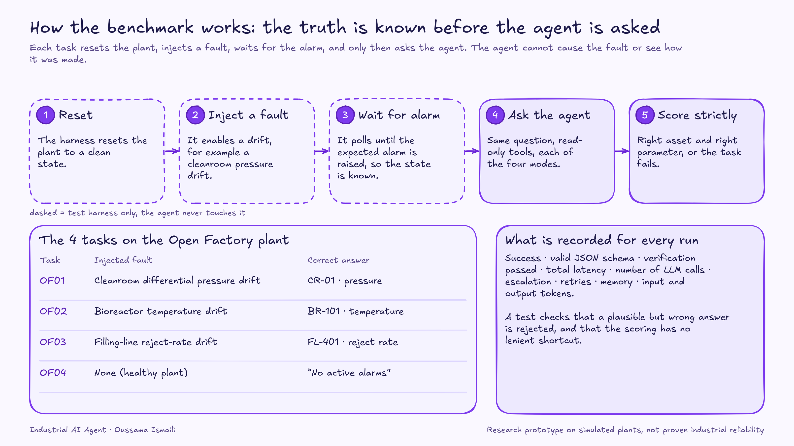

## Results

One run per mode. Latency is in seconds.

**Synthetic factory**: 3 tasks (downtime analysis, production lookup, scheduling analysis).

| Mode | Task success | Verification pass | Median latency | p95 latency | Escalation |
|---|---|---|---|---|---|
| `baseline` | 0.00 | n/a | 0.70 | 2.22 | 0.00 |
| `tool` | 0.67 | n/a | 2.09 | 2.61 | 0.00 |
| `verified` | 0.67 | 1.00 | 1.56 | 10.68 | 0.00 |
| `hybrid` | **1.00** | 1.00 | 9.54 | 23.46 | 0.00 |

**External plant (Open Factory Demo Factory)**: 4 tasks (3 fault diagnoses and 1 healthy plant where the right answer is "no active alarms"). Raw results are in `experiments/results_openfactory.jsonl`.

| Mode | Task success | Verification pass | Median latency | p95 latency | Escalation |
|---|---|---|---|---|---|
| `baseline` | 0.00 | n/a | 0.55 | 0.78 | 0.00 |
| `tool` | **1.00** | n/a | 1.83 | 3.17 | 0.00 |
| `verified` | **1.00** | 1.00 | 13.38 | 19.71 | 0.00 |
| `hybrid` | **1.00** | 1.00 | 6.73 | 11.68 | 0.00 |

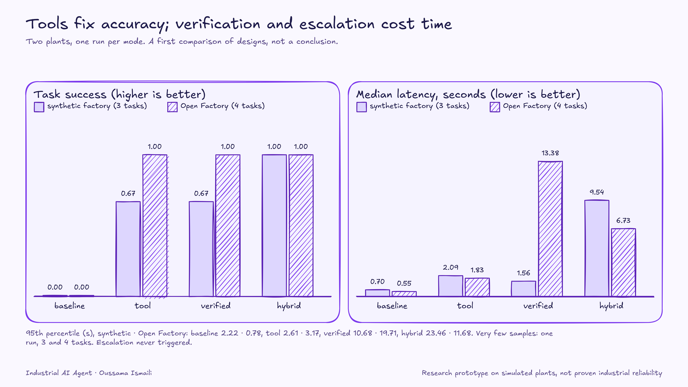

**What this shows**

- **Grounding comes first.** With no access to plant data, the baseline solved none of the tasks on either plant. Read-only tools took the external plant from 0 to 4 of 4.
- **Verification costs time.** On the external plant, `verified` reached the same accuracy as `tool` but with a 13.4 s median instead of 1.8 s. On this task set the check did not buy extra accuracy.
- **A small model first can be cheaper than always verifying.** `hybrid` solved every task on both plants. On the external plant its median was about half that of `verified`. On the simulator it was the only mode to reach 1.00.
- **The right mode is a use-case decision.** An interactive question favours `tool`. A planning job that can wait can afford `hybrid`.

**Limits.** With 3 and 4 tasks, success moves in steps of 0.33 and 0.25, and p95 rests on very few samples. Escalation never triggered on either plant, so that path is untested. Treat these numbers as a first comparison, not a conclusion. The next step is repeated runs and a broader scenario set.

## Run it

**First time** (needs Docker and a Groq API key in `.env`; copy `.env.example`):

```bash
# Start the external plant and the MCP server
docker compose --profile openfactory up -d --build openfactory-api mcp-server-openfactory

# Benchmark the agent on the external plant, tools called through MCP
docker compose --profile openfactory run --rm benchmark-openfactory \
  python -m src.evaluation.runner --backend openfactory --transport mcp

# Results table
docker compose --profile openfactory run --rm benchmark-openfactory \
  python -m src.evaluation.metrics

# Interactive UI at http://localhost:8501
docker compose --profile openfactory up --build -d ui
```

**Original synthetic-factory benchmark:**

```bash
docker compose run --rm benchmark
```

**Without Docker:** `pip install -r requirements.txt`, then `python -m src.evaluation.runner --backend simulator` and `pytest`. Live tests skip unless a Demo Factory is reachable on `:8000`.

**Next time:** the images are already built, so `docker compose --profile openfactory up -d openfactory-api mcp-server-openfactory ui` is enough. Stop with `docker compose --profile openfactory down`.

## Tests

37 automated tests: 31 run anywhere against recorded plant responses, and 6 more run against a live Demo Factory and are skipped otherwise.

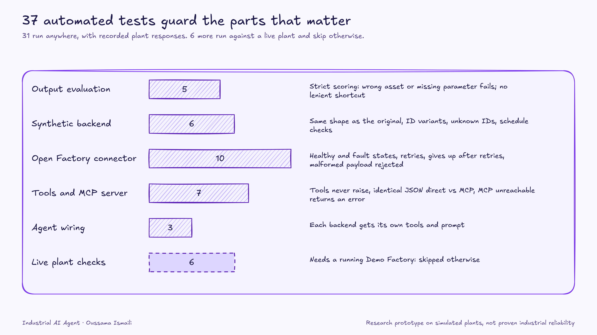

## Deployment

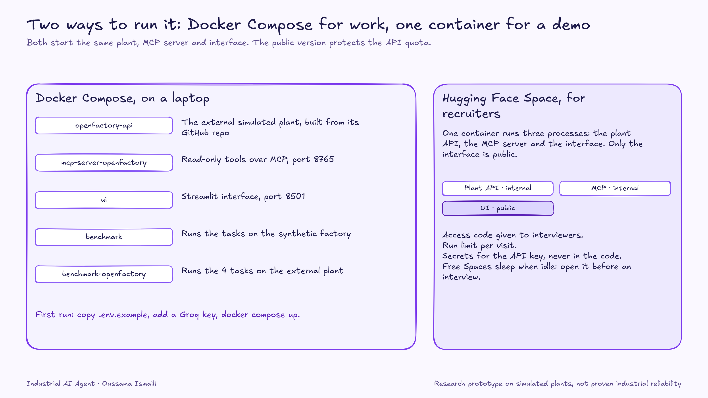

Docker Compose runs the plant, the MCP server, the Streamlit UI and both benchmarks. For a public demo, `deploy/huggingface/` holds a single-container Hugging Face Space with an access code and a run limit to protect the API quota. Free Spaces sleep when idle.

## Taking it to a real factory

1. **Sit with the users.** Shadow planners and line supervisors to find the questions they ask daily before choosing what to automate.
2. **Connect to the real systems, read-only first.** The backend interface and the Open Factory connector are the pattern. Replace them with the customer's MES, ERP or SCADA. OPC UA is the natural next protocol.
3. **Enforce real constraints.** Wire the capacity and availability validator into the main workflow. It exists separately today.
4. **Build the benchmark with the customer.** Use their real scenarios, failures and edge cases, with repeated runs for statistical confidence.
5. **Roll out gradually.** Recommendations first, human approval always, and a wider scope as trust is earned. Track cost per answer and escalation rate in production.

## Known gaps and next steps

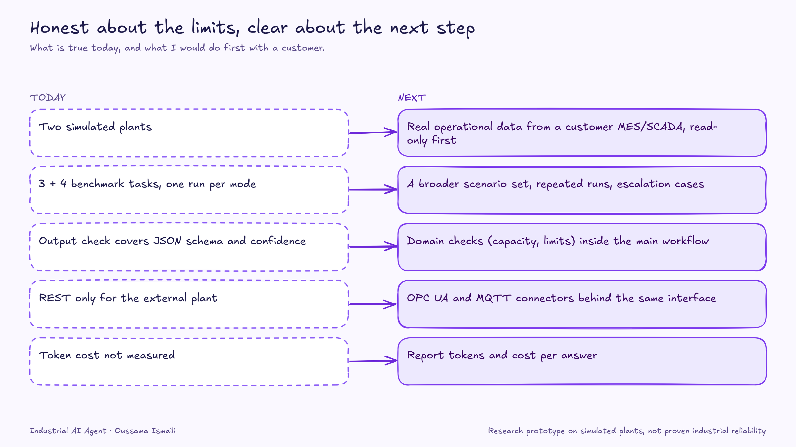

| Today | Next |
|---|---|
| Two simulated plants | Real operational data from a customer MES/SCADA, read-only first |
| 3 + 4 benchmark tasks, one run per mode | A broader scenario set, repeated runs, escalation cases |
| Output check covers JSON schema and confidence | Domain checks (capacity, limits) inside the main workflow |
| REST only for the external plant | OPC UA and MQTT connectors behind the same interface |
| Token cost not measured | Report tokens and cost per answer |
| Compose file not exercised in CI | CI running tests and a smoke benchmark |

**Verified:** the connector, the MCP server (including real HTTP) and the tools against recorded real Demo Factory payloads. Against a live Demo Factory, an LLM-free "oracle" solves all 4 tasks from tool output alone, which shows each task is solvable and that scoring rejects wrong answers.

## Repository layout

```
src/agents/        LangGraph workflow and the four modes
src/backends/      FactoryBackend interface, simulator and Open Factory connector
src/tools/         Read-only tools (direct and MCP transports)
src/mcp_server/    MCP server
src/evaluation/    Scenarios, runner and metrics
src/ui/            Streamlit app
deploy/huggingface Single-container demo kit
docs/diagrams/     Diagrams (PNG and editable Excalidraw files)
tests/             37 tests
```

## About me

**Oussama Ismaili**, engineering student in AI (EILCO / ENSIAS), looking for an end-of-studies AI internship. I like turning a customer's operational problem into a working, measured solution.
[GitHub](https://github.com/oussamaissm)

## Credits

The external plant is the [Open Factory Demo Factory](https://github.com/Open-Factory-Initiative/Demo-Factory). Diagrams are drawn in Excalidraw style, and the editable sources are in `docs/diagrams/excalidraw/`.